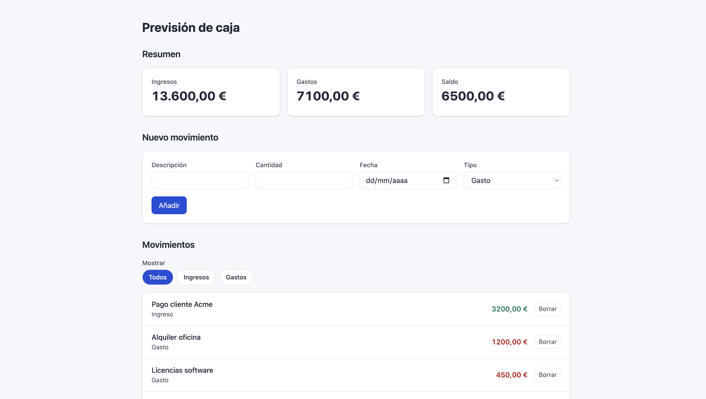

# Cash Dashboard

A small cash-flow forecast dashboard built with React, TypeScript and Vite. It shows income, expenses and balance, and lets you add, delete and filter transactions.

I built it to practise frontend fundamentals step by step: state management, typing, accessibility and layout.



## Features

- Summary cards with total income, expenses and balance
- Transaction list loaded from a REST endpoint, with loading and error states
- Form to add transactions, with validation
- Delete transactions
- Filter by type (all, income, expenses)
- Currency formatting with `Intl.NumberFormat` (es-ES, EUR)

## Tech stack

React · TypeScript · Vite · CSS (custom properties, Grid, Flexbox, BEM)

## Technical decisions

- **Custom hook (`useTransactions`)** handles data fetching, loading and error states, and exposes `addTransaction` and `removeTransaction`. Components never see `dispatch`.
- **`useReducer` with a discriminated union** for actions (`loaded`, `added`, `removed`), so each action has a typed payload.
- **Derived state:** totals are calculated from the transactions on every render instead of being stored, so the list and the summary can't get out of sync.
- **Pure functions** in `utils/` for formatting, summary calculation and form validation, which keeps components simple and makes them easy to test.
- **Controlled form** that converts and validates values on submit.
- **`useMemo`** for the filtered list. With this amount of data it isn't needed for performance; I used it to practise and to keep a stable result between renders.
- **Accessibility:** semantic HTML, labelled sections, a `fieldset` for the filter, native radios hidden only visually so keyboard navigation still works, visible focus, descriptive `aria-label` on delete buttons, `role="alert"` on errors and AA colour contrast.
- **Design tokens** as CSS custom properties for colours, spacing and shadows.

## Getting started

```bash
npm install
npm run dev
```

Then open http://localhost:5173.

## Project structure

```
src/
  components/   UI components (form, filters)
  hooks/        useTransactions
  state/        transactions reducer
  types/        shared types
  utils/        formatting, summary and validation
public/api/     mock REST data (transactions.json)
```

## Known limitations

- The API is mocked with a static JSON file, so new or deleted transactions are lost on reload.

## Next steps

- Monthly chart with Recharts
- Unit and component tests with Vitest and Testing Library
- Persist data (localStorage or a real API)